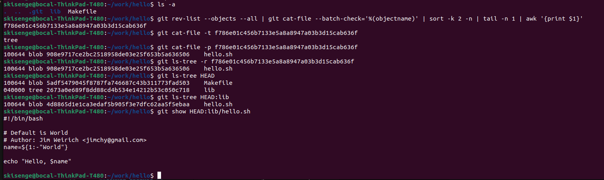

# Setting Up Git: A Comprehensive Guide

## Installing Git

To use Git, you'll need to install it on your local machine. Follow these steps based on your operating system:

### Windows

1. Download Git from the official Git website: [https://git-scm.com/downloads](https://git-scm.com/downloads)
2. Run the installer and follow the prompts.
3. After installation, you can use Git from the Command Prompt or PowerShell.
4. Git Bash, a Unix-like command line interface, is also installed and can be used as an alternative.

### macOS

1. Open the Terminal app.
2. Check if Git is already installed by running:

   ```bash
   git --version
   ```

3. If Git is not installed, you have two options:
   a. Install using Homebrew (if you have it installed):

      ```bash
      brew install git
      ```

   b. Download the installer from the official Git website: [https://git-scm.com/downloads](https://git-scm.com/downloads)

### Linux

Open a terminal and run one of the following commands:

- For Ubuntu-based systems:

  ```bash
  sudo apt-get install git
  ```

- For RHEL-based systems:

  ```bash
  sudo yum install git
  ```

## Configuring Git

After installing Git, configure it with your username and email address:

```bash
git config --global user.name "Your Name"
git config --global user.email "your_email@example.com"
```

Replace "Your Name" and "<your_email@example.com>" with your actual name and email address.

### Setting Default Branch Name

Many Git installations now default to 'main' instead of 'master'. Set your default branch name:

```bash
git config --global init.defaultBranch <default_branch>
git config --global init.defaultBranch master
```

### Verifying the Configuration

To verify your configuration:

```bash
git config --global --list
```

This will output a list of your configuration settings, including your username and email address.

## Advanced Setup (Optional)

### Setting Up SSH Keys

If you're using a Git hosting service like GitHub, you may want to set up SSH keys for secure, password-less authentication:

1. Generate an SSH key:

   ```bash
   ssh-keygen -t ed25519 -C "your_email@example.com"
   ```

2. Add the SSH key to your SSH agent:

   ```bash
   eval "$(ssh-agent -s)"
   ssh-add ~/.ssh/id_ed25519
   ```

3. Add the public key to your Git hosting service account.

### Global .gitignore

Create a global .gitignore file to specify files that Git should ignore across all repositories:

```bash
git config --global core.excludesfile ~/.gitignore_global
```

Then, edit `~/.gitignore_global` to add file patterns to ignore.

## Git GUI Clients

While Git is primarily used via command line, there are several GUI clients available for those who prefer graphical interfaces:

- GitHub Desktop
- Sourcetree
- GitKraken
- Tower

Choose one that suits your preferences and workflow.

## Conclusion

You're now set up to use Git on your local machine! Remember to regularly update Git to the latest version for security patches and new features.

---

# Git Commits to Commit

## Step 1: Create a Subdirectory and File

Within the work directory, establish a subdirectory named hello. Inside this directory, generate a file titled hello.sh and input the following content:

```bash
echo "Hello, World" >> hello.sh
```

## Initialize Git Repository and Check Status

- Initialize the Git repository in the hello directory using the command:

```bash
git init
```

- Check the status of the repository using the command:

```bash
git status
```

- The output should indicate that the directory is empty.

## Modify File and commit Changes

- Modify the hello.sh file to include comments and stage the changes:

```bash
#!/bin/bash

# Default is "World"
name=${1:-"World"}
echo "Hello, $name"
```

- Stage the changed file, but in patches, the first should include the line 3 comment while the other should noe include the rest of the lines 4 and 5. Use the command:

```bash
git add -p
```

## Commit Changes

- Commit 1: Commit the comment added in line 3.

```bash
git commit -m "add comment here"
```

- When we git status after this, we realize we have the same file in the staging area and as untracked, to mean we committed the first change but did not the later changes in the file. Commit 2: Commit changes made to lines 4 and 5.

```bash
git add hello.sh
git commit -m "Modified hello.sh script"
```

- The working tree should now be clean.

---

# _*History*_

## _*Show History*_

- To show the history of the working directory, run:

```bash
git log
```

### _*One-Line History*_

- To view a condensed one-line history showing only commit hashes and messages, run:

```bash
git log --oneline
```

### _*Customized Log Output*_

- To customize the log output, specify the number of entries or a time range. To display the last 2 entries, run:

```bash
git log -n 2
```

- To view the commits made within the last 5 minutes, run:

```bash
git log --since=5minutes
```

### _*Personalized Format*_

- To show logs in a personalized format, including the commit hash, date, message, branch information, and author name, run:

```bash
git log --pretty=format:"* %h %ad | %s (%d) [%an]" --date=short
```

- This will display the output in a format resembling:

```bash
* e4e3645 2023-06-10 | Added a comment (HEAD -> main) [John Doe]
```

- Note:
  - ``%h`` represents the commit hash
  - ``%as``  represents the date in the short format.
  - ``%ad`` represents the date in the long format.
  - ``%s`` represents the commit message
  - ``%d``  represents the abbreviated commit ref name (e.g. main)
  - ``%cr`` represents the commit message duration
  - ``%an``  represents the author name.

## Attached Display


---

# _*Checkout*_

## _*Restore First Snapshot*_

- Find the hash of the initial commit by running:

```bash
git rev-list --max-parents=0 HEAD
```

- Once you have the hash of the initial commit, detach the head to that commit and print the content:

```bash
git checkout <initial-commit-hash>
cat hello.sh
```

- To revert to initial version, run:

```bash
git checkout main/master
```

## _*Restore Second Recent Snapshot*_

- To revert the working tree to the second most recent snapshot and print the content of the hello.sh file, run:

```bash
git checkout HEAD~1
cat hello.sh
```

Also

```bash
git rev-list --skip=1 -n 1 HEAD
git checkout <second-recent-commit-hash>
cat hello.sh
```

- This will revert the working tree to the second most recent snapshot and display the content of the hello.sh file.

## _*Return to Latest Version*_

- To ensure that the working directory reflects the latest version of the hello.sh file present in the main branch, without referring to specific commit hashes, run:

```bash
git checkout main
cat hello.sh
```

- Note:
  - The ``HEAD~1`` syntax refers to the first parent commit of the current commit
  - ``HEAD~2`` refers to the second parent commit. By checking out these commits, you can revert to previous versions of your files.
  - After reverting to the initial commit, we cannot literally switch to the latest commit by the ``git checkout main`` command, since, the later commits were deleted. To reverse the process, you can track the latest commit hash by running ``git reflog`` and checkout revert to the hash, this will reset things back to normal.
  - ``git reflog:`` This command shows a log of changes to the tips of branches and other references in the repository. It includes actions like checkouts, commits, resets, and more.

  - ``git rev-list:`` This command lists commit objects in reverse chronological order.
  - ``--max-parents=0:`` This option filters the commits to only those with zero parents, which means it will list the root commits (initial commits) of the repository.
  - ``--skip=1:`` This option skips the first commit in the list. In this context, it skips the most recent commit.
  - ``-n 1:`` This option limits the output to only one commit.
  - ``HEAD:`` Refers to the latest commit in the current branch.


---

# _*Tagging*_

## _*Referencing Current Version**_

- To tag the current version of the repository as ``v1``, run:

```bash
git tag v1
```

- This will create a new tag v1 referencing the current commit.

## _*Tagging Previous Version*_

- To tag the version immediately prior to the current version as v1-beta, without relying on commit hashes to navigate through the history, run:

```bash
git tag v1-beta HEAD~1 (also HEAD^)
```

## _*Navigating Tagged Versions*_

- To move back and forth between the two tagged versions, v1 and v1-beta, use the following commands:
  - To switch to v1:

```bash
git checkout v1
```

- To switch to v1-beta:

```bash
git checkout v1-beta
```

## _*Listing Tags*_

- To display a list of all tags present in the repository to verify successful tagging, run:

```bash
git tag
```

- This will show a list of all tags in your repository, including v1 and v1-beta.
- And now if we `git log` we should be able to see this kind of an output.

## Tags Display


---

# _*Changed Your Mind?*_

## _*Reverting Changes*_

- Revert the changes back to their original state:-

```bash
# git checkout -- hello.sh
git restore hello.sh
```

- This will discard any local changes made to the file and restore it to its previous state.

## _*Staging and Cleaning*_

- Stage changes:

```bash
git add hello.sh
```

- Clean the staging area:

```bash
git restore --staged <filename>
# git reset HEAD <filename>
```

to discard the changes:

```bash
git restore <filename>
```

## _*Committing and Reverting*_

- Add the following unwanted changes again, stage the file, commit the changes, then revert them back to their original state, follow these steps:

```bash
git add hello.sh
git commit -m "Chore: commit unwanted changes to be reverted"
git revert HEAD^
```

## _*Tagging and Removing Commits*_

### _*Tagging the Latest Commit*_

- To tag the latest commit with ``oops``, run the following command:

```bash
git tag oops HEAD
```

### _*Removing Commits*_

- To remove commits made after the v1 version:

```bash
git reset --hard v1
```

### _*Ensuring HEAD Points to v1*_

- Verify that the HEAD now points to the commit with the tag v1 by running:

```bash
git log -1
```

## Tags display


### _*Displaying Logs with Deleted Commits*_

#### _*Showing Logs with Deleted Commits*_

- To display logs with deleted commits, including the one tagged as oops, run:

```bash
git log --graph --all
```

#### _*Cleaning Unreferenced Commits*_

- To ensure that unreferenced commits are deleted from history, use:

```bash
git prune
# git gc --prune=now
```

#### _*Author Information*_

- To add an author information to the file, open it in a text editor and add a line at the top:

```bash
#!/bin/bash

# Default is World
# Author: Jim Weirich
name=${1:-"World"}

echo "Hello, $name"

```

#### _*Adding the Author's email*_

- To do this without making a new commit!
- After making the changes on the file, we are going to do a special commit:

```bash
git commit --amend --no-edit
```

- This will update the commit message without changing the commit itself.


## **Note:**

### _**Key differences between git prune and git gc --prune=now:**_

**Pruning:** Both commands remove unreferenced objects, but `git prune` is more focused on this task, while `git gc` also performs other optimizations.

**Garbage collection:** `git gc` performs a more comprehensive cleanup of your repository, including repacking objects, which can improve performance.

**Timing:** ``git prune`` can be run independently, while `git gc` is typically part of a larger repository maintenance process.


---

# _*Moving Files and Creating a Makefile*_

## _*Moving the hello.sh File*_

- Use the following Git commands to move the hello.sh file into a new directory named lib:

```bash
mkdir lib
git mv hello.sh lib/
```

- Commit the move:

```bash
git add .
git commit -m "Moved hello.sh to lib directory"
```

- Create a new file named Makefile:

```bash
touch Makefile
```

in the root directory of the repository with the following content:

```bash
echo -e "TARGET=\"lib/hello.sh\"\n\nrun:\n\tbash \${TARGET}" > Makefile
git add Makefile
git commit -m "Added Makefile"
```

- Commit the new file.

---

# _*Blobs, trees and commits*_

- _Blobs_ are the contents of the files that we make Git aware about.
- _Trees_ are the working structure of a branch.

## _*Exploring the .git/ Directory*_

- ``cd`` into the ``.git/`` directory in your project and let's examine its contents.
- The `.git` repo contains all the metadata for the your local repository.
- We will find several subdirectories and files that play a crucial role in managing our Git repository.
- Let's explore each of them:

     **branches/:**

    This directory is used by older versions of Git for storing branch information. It's generally empty in modern Git versions because branches are now managed within the refs/ directory.

    **COMMIT_EDITMSG:**

    This file contains the commit message of the most recent commit. When you run git commit, Git opens this file in your text editor for you to edit the commit message.

    **config:**

    This file stores configuration settings for the repository. These settings can include user information, remotes, and other repository-specific settings.

    **description:**

    This file is used by GitWeb to provide a description of the repository. It's generally not used by standard Git operations.

    **HEAD:**

    This file points to the current branch reference. It typically contains a reference like ref: refs/heads/main, indicating the current active branch.

    **hooks/:**

    This directory contains client- or server-side scripts that are triggered by Git events, such as pre-commit, post-commit, pre-push, etc. These hooks can be used to enforce policies or automate workflows.

    **index:**

    This file is also known as the staging area. It contains information about what will go into the next commit, including file changes that have been added but not yet committed.

    **info/:**

    This directory contains auxiliary information. For example, the exclude file in this directory can be used to specify patterns for files to be ignored in this specific repository.

    **logs/:**

    This directory contains logs of changes to the tips of branches. Each file in logs/refs/ keeps a record of all commits made to the respective branch. This can be useful for recovering lost commits.

    **objects/:**

    This directory stores all the content (files and directories) in the repository in an object database. Each object is identified by its SHA-1 hash. The objects can be of four types: blobs (file data), trees (directories), commits (commit data), and tags (tag data).

    **ORIG_HEAD:**

    This file is used to store the original HEAD reference before a potentially dangerous operation like a rebase or merge. It's used to help you recover if something goes wrong.

    **packed-refs:**

    This file stores references in a packed format for efficiency. It's used to speed up operations on repositories with a large number of references (branches or tags).

    **refs/:**

    This directory contains references to commit objects. It's subdivided into heads/ for local branches, remotes/ for remote-tracking branches, and tags/ for tags.

### _Latest Object Hash_

- To find the latest object hash within the .git/objects/ directory, use the following Git command:

```bash
git rev-list --objects --all | git cat-file --batch-check='%(objectname)' | sort -k 2 -n | tail -n 1 | awk '{print $1}'
```

- Then, you can use the following command to determine the type and content of this object:

```bash
git cat-file -t <latest-object-hash> && git cat-file -p <latest-object-hash>
```

### _*Dumping Directory Tree*_

- Use Git commands to dump the directory tree referenced by this commit:

```bash
git ls-tree -r <latest-object-hash> 
```

- To dump the directory tree referenced by a specific commit and the contents of the lib/ directory and hello.sh file, you can use the following Git commands:

```bash
# Dump the directory tree of the latest commit
git ls-tree HEAD

# Dump the contents of the lib/ directory
git ls-tree HEAD:lib

# Show the content of hello.sh
git show HEAD:lib/hello.sh
```

- The output will be the actual contents of the hello.sh file

## _Note_

To get the latest commit;

```bash
git rev-parse HEAD

# Get the latest commit hash
latest_hash=$(git rev-parse HEAD)

# Print the type of the object
git cat-file -t $latest_hash

# Print the content of the object
git cat-file -p $latest_hash
```

## Working directory well displayed



---

# _*Branching in Git*_

## _*Creating and Switching to a New Branch*_

- Create a local branch named ``greet`` and switch to it using the following Git command:

```bash
git branch greet
git checkout greet
```

Also can use a single command:

```bash
git checkout -b greet
```

Adding Changes to the greet Branch

- In the lib directory, create a new file named ``greeter.sh`` and add the provided and commit the changes:

```bash
#!/bin/bash

Greeter() {
    who="$1"
    echo "Hello, $who"
}
```

Adding Changes to the greeter.sh file

```bash
echo -e '#!/bin/bash\n\nGreeter() {\n\twho="$1"\n\techo "Hello, $who"\n}' > lib/greeter.sh
git add lib/greeter.sh
git commit -m "Added greeter.sh file"
```

- Next, update the lib/hello.sh file by adding the content below, staging and committing the changes:

```bash
#!/bin/bash

source lib/greeter.sh

name="$1"
if [ -z "$name" ]; then
    name="World"
fi

Greeter "$name"
```

Update changes:

```bash
echo -e '#!/bin/bash\n\nsource lib/greeter.sh\n\nname="$1"\nif [ -z "$name" ]; then\n\tname="World"\nfi\n\nGreeter "$name"' > lib/hello.sh
git add lib/hello.sh
git commit -m "Updated hello.sh to use Greeter"
```

## _*Updating the Makefile*_

```bash
echo "# Ensure it runs the updated lib/hello.sh file" >> Makefile
git add Makefile
git commit -m "Updated Makefile"
```

## _*Comparing Branches*_

- Switch back to the main branch using:

```bash
git checkout master
```

### _*Difference*_

- To compare and show the differences between branches in Git, you can use the ``git diff`` command with the ``--stat`` option:

```bash
(git diff <branch1> <branch2> --stat -- <file to compare>)
git diff master greet -- Makefile lib/hello.sh lib/greeter.sh

```

- This will show a summary of the changes, including the number of added, modified, and deleted lines of a specific file.

```bash
diff --git a/Makefile b/Makefile
index 5adf547..8268405 100644
--- a/Makefile
+++ b/Makefile
@@ -3,3 +3,4 @@ TARGET="lib/hello.sh"
 run:
        bash ${TARGET}
 
+# Ensure it runs the updated lib/hello.sh file
diff --git a/lib/greeter.sh b/lib/greeter.sh
new file mode 100644
index 0000000..28da219
--- /dev/null
+++ b/lib/greeter.sh
@@ -0,0 +1,6 @@
+#!/bin/bash
+
+Greeter() {
+       who=\"$1\"
+       echo \"Hello, $who\"
+}
diff --git a/lib/hello.sh b/lib/hello.sh
index 4d8865d..ca4823e 100644
--- a/lib/hello.sh
+++ b/lib/hello.sh
@@ -1,8 +1,10 @@
 #!/bin/bash
 
-# Default is World
-# Author: Jim Weirich <jimchy@gmail.com>
-name=${1:-"World"}
+source lib/greeter.sh
 
-echo "Hello, $name"
+name="$1"
+if [ -z "$name" ]; then
+       name="World"
+fi
 
+Greeter "$name"
```

## _*Create README.md*_

```bash
echo "This is the Hello World example from the git project." > README.md
git add README.md
git commit -m "Add README.md"
```

## _*Commit Tree Diagram*_

- To have a graphical representation of the commits, we run:

```bash
git log --graph master greet --oneline

(Alternatively)
git log --graph --oneline --all
```

Illustration:

```bash
skisenge@bocal-ThinkPad-T480:~/work/hello$ git log --graph --all --oneline
* fabcd2f (HEAD -> master) Add README.md
| * 4dccbcc (greet) Updated Makefile
| * aa37108 Updated hello.sh to use Greeter
| * 98f9cd7 Added greeter.sh
|/  
* 2e4f379 feat: add script into Makefile
* 608709d style: move hello.sh file to lib/
* a94661e chore: Add author infomation
| * c1ef1f9 (tag: oops) Chore: commit unwanted changes to be reverted
|/  
* 82b3dd1 (tag: v1) feat: update name in line 4 & 5
* 7890f3d (tag: v1-beta) chore: insert comment in line 3
* 941d157 feat: added bash content
skisenge@bocal-ThinkPad-T480:~/work/hello$ git log --graph master greet --oneline
* fabcd2f (HEAD -> master) Add README.md
| * 4dccbcc (greet) Updated Makefile
| * aa37108 Updated hello.sh to use Greeter
| * 98f9cd7 Added greeter.sh
|/  
* 2e4f379 feat: add script into Makefile
* 608709d style: move hello.sh file to lib/
* a94661e chore: Add author infomation
* 82b3dd1 (tag: v1) feat: update name in line 4 & 5
* 7890f3d (tag: v1-beta) chore: insert comment in line 3
* 941d157 feat: added bash content
skisenge@bocal-ThinkPad-T480:~/work/hello$ 

```

---

# _*Conflicts, Merging, and Rebasing*_

## _*Merging Main into Greet Branch*_

- Switch to the greet branch and attempt to merge the changes from the main branch using:

```bash
git checkout greet
git merge master
```

- switch back to master and make changes to hello.sh and commit.

```bash
git checkout master
echo -e '#!/bin/bash\n\necho "What\'s your name"\nread my_name\n\necho "Hello, $my_name"' > lib/hello.sh
git add lib/hello.sh
git commit -m "Asking for user's name update"
```

## _*Merging Main into Greet Branch (Conflicts)*_

```bash
git checkout greet
git merge master
```

- This will create a conflict that need be resolved.

```bash
# Manual resolution of conflicts in lib/hello.sh in the editor and commit.
git add lib/hello.sh
git commit -m "Resolved merge conflicts"
```

Commits after merge conflict:

```bash
    skisenge@bocal-ThinkPad-T480:~/work/hello$ git log --oneline
    a884f04 (HEAD -> greet) Resolved merge conflicts
    3ccf340 (master) Asking for users name update
    7e7e26b Merge branch 'master' into greet
    fabcd2f Add README.md
    4dccbcc Updated Makefile
    aa37108 Updated hello.sh to use Greeter
    98f9cd7 Added greeter.sh
    2e4f379 feat: add script into Makefile
    608709d style: move hello.sh file to lib/
    a94661e chore: Add author infomation
    82b3dd1 (tag: v1) feat: update name in line 4 & 5
    7890f3d (tag: v1-beta) chore: insert comment in line 3
    941d157 feat: added bash content
```

## _*Rebasing Greet Branch*_

- Rebase is a Git command that replays your local commits onto a new base commit, effectively "rewriting" your commit history.
- To rebase the greet branch on top of the latest changes in the main branch, use:

```bash
git checkout greet
git reset --hard aa37108
git rebase master
# conflict arises then we solve conflict in the editor
git add lib/hello.sh
git rebase --continue
# Output: Successfully rebased and updated refs/heads/greet.
```

- This will reapply the commits from the greet branch on top of the latest changes in the main branch.

### _*Merging Greet into Main*_

- Switch to the main branch and merge the changes from the greet branch using:

```bash
git checkout master
git merge greet
```

- This will create a new merge commit that combines the changes from both branches.

### _*Understanding Fast-Forwarding and Differences*_

- Fast-forwarding occurs when you merge one branch into another and there are no conflicts. In this case, Git simply moves the branch pointer to point to the latest commit on the target branch.

- Merging and rebasing are two different ways to integrate changes from one branch into another. Merging creates a new commit that combines the changes from both branches, while rebasing rewrites the commits from one branch onto another. When you rebase a branch, you are effectively rewriting history, whereas merging preserves the original commit history.

- Here's a simple way to remember it:

  - `Merging:` Creates a new commit that combines changes from both branches.
  - ``Rebasing:`` Rewrites commits from one branch onto another, preserving history.
  - ``Fast-forwarding:`` No conflicts or rewriting of history occurs when merging or rebasing.

---

# _*Local and Remote Repositories*_

- To create a copy of the original repo called ``hello/`` in another directory called ``clone_hello/``, using the command:

```bash
cd ..
# git clone <path_to_original_repository> cloned_hello
git clone hello/ cloned_hello
```

## _*Showing Logs for the Cloned Repository*_

```bash
cd cloned_hello
git log --oneline
```

Output:

```bash
    skisenge@bocal-ThinkPad-T480:~/work$ ls
    cloned_hello  documentation  hello
    skisenge@bocal-ThinkPad-T480:~/work$ cd cloned_hello/
    skisenge@bocal-ThinkPad-T480:~/work/cloned_hello$ git log --oneline
    c23b48a (HEAD -> master, origin/master, origin/greet, origin/HEAD) Added greeter.sh
    3ccf340 Asking for users name update
    fabcd2f Add README.md
    2e4f379 feat: add script into Makefile
    608709d style: move hello.sh file to lib/
    a94661e chore: Add author infomation
    82b3dd1 (tag: v1) feat: update name in line 4 & 5
    7890f3d (tag: v1-beta) chore: insert comment in line 3
    941d157 feat: added bash content
    skisenge@bocal-ThinkPad-T480:~/work/cloned_hello$ 

```

## _*Displaying Remote Repository Information*_

```bash
# display name
git remote -v
# display more information
git remote show origin
```

Output:

```bash
    skisenge@bocal-ThinkPad-T480:~/work/cloned_hello$ git remote
    origin
    skisenge@bocal-ThinkPad-T480:~/work/cloned_hello$ git remote -v
    origin /home/skisenge/work/hello/ (fetch)
    origin /home/skisenge/work/hello/ (push)
    skisenge@bocal-ThinkPad-T480:~/work/cloned_hello$ git remote show origin
    * remote origin
    Fetch URL: /home/skisenge/work/hello/
    Push  URL: /home/skisenge/work/hello/
    HEAD branch: master
    Remote branches:
        greet  tracked
        master tracked
    Local branch configured for 'git pull':
        master merges with remote master
    Local ref configured for 'git push':
        master pushes to master (up to date)

```

## _*Listing Remote and Local Branches*_

```bash
# list local branches
git branch
# list remote branches
git branch -r
# lisst all branches
git branch -a
```

Output:

```bash
    skisenge@bocal-ThinkPad-T480:~/work/cloned_hello$ git branch
    * master
    skisenge@bocal-ThinkPad-T480:~/work/cloned_hello$ git branch -r
    origin/HEAD -> origin/master
    origin/greet
    origin/master
    skisenge@bocal-ThinkPad-T480:~/work/cloned_hello$ git branch -a
    * master
    remotes/origin/HEAD -> origin/master
    remotes/origin/greet
    remotes/origin/master
    skisenge@bocal-ThinkPad-T480:~/work/cloned_hello$ 

```

## _*Making Changes to the Original Repository*_

- Make changes to the original repository by updating the README.md file with the provided content. Commit the changes using.

```bash
echo 'This is the Hello World example from the git project.' > README.md
echo '(changed in the original)' >> README.md 
git add README.md
git commit -m "Updated README.md in original"
```

## _*Fetching Changes from Remote Repository*_

- Inside the cloned repository, fetch the changes from the remote repository and display the logs using:

```bash
cd ../cloned_hello
git fetch origin
git log --all --decorate --oneline
# Alternatively
git log --oneline --graph --all
```

Output:

```bash
    skisenge@bocal-ThinkPad-T480:~/work/cloned_hello$ git log --all --decorate --oneline
    bdb775a (origin/master, origin/HEAD) Updated README.md in original
    c23b48a (HEAD -> master, origin/greet) Added greeter.sh
    3ccf340 Asking for users name update
    fabcd2f Add README.md
    2e4f379 feat: add script into Makefile
    608709d style: move hello.sh file to lib/
    a94661e chore: Add author infomation
    c1ef1f9 (tag: oops) Chore: commit unwanted changes to be reverted
    82b3dd1 (tag: v1) feat: update name in line 4 & 5
    7890f3d (tag: v1-beta) chore: insert comment in line 3
    941d157 feat: added bash content

```

- This includes commits from the hello repository.

## _*Merging Changes from Remote Main Branch into Local Main Branch*_

- Merge the changes from the remote main branch into the local main branch using:

```bash
git merge origin/main
```

- After merging and we try to run the `git log --oneline` command again:

## _*Adding a Local Branch Tracking Remote Origin/Greet Branch*_

- Add a local branch named greet tracking the remote origin/greet branch using:

```bash
git checkout --track origin/greet
#git checkout -b greet --track origin/greet
```

- ``--track origin/greet`` : Sets the upstream branch for the greet branch to origin/greet, which means that the greet branch will track the remote origin/greet branch.
- ``git branch -vv`` command. This will show all the local branches along with their tracking configuration. You should see the greet branch listed with its upstream branch set to origin/greet.

## _*Adding a Remote and Pushing Branches to Remote*_

```bash
git remote add shared /path/to/shared/repo.git

git remote add shared https://learn.zone01kisumu.ke/git/skisenge/git.git
git push -u shared master
git push -u shared greet
# If you want to use 'origin' as name and is already set: see notes below under topic "## Using `Origin` as Name" 
git remote set-url origin https://learn.zone01kisumu.ke/git/skisenge/git.git
# Use git remote -v to check if well set the push the branches;
git push -u origin master
git push -u origin greet
```

- This command pushes the greet branch to the remote repository and sets the upstream branch for the local greet branch to the remote origin/greet branch.
- After running this command, any subsequent ``git push`` or ``git pull`` commands on the greet branch will automatically use the origin/greet branch as the upstream branch.

### _*Short Hand git command*_

- Well, the single command that will, fetch the latest version of the code from Git main branch, and then merge it with our new, local changes is:

```bash
git pull origin main
```

## **Understanding `git remote add`**

## Basic Syntax

The basic syntax for adding a remote in Git is:

```bash
git remote add <name> <url>
```

Here, `<name>` is a short name you choose to refer to the remote repository, and `<url>` is the URL of the remote repository.

## Why We Need a Name

1. **Multiple Remotes**: Git allows you to have multiple remote repositories connected to your local repository. The name helps distinguish between these remotes.

2. **Convenient Reference**: Instead of typing out the full URL every time, you can use the short name in Git commands.

3. **Clarity in Collaboration**: When working in teams, meaningful remote names can indicate the purpose or owner of each remote.

## Example

```bash
git remote add shared https://github.com/example/repo.git
```

Here, "shared" is the name we've chosen for this remote. We could have used any name: "origin", "upstream", "john_fork", etc.

## Common Remote Names

- `origin`: By convention, this usually refers to the main remote repository.
- `upstream`: Often used when you've forked a repository, to refer to the original repository.

## Using Remote Names

After adding a remote, you can use its name in other Git commands:

```bash
git fetch shared
git push shared master
git pull shared feature-branch
```

## What Happens Without a Name

If you try `git remote add <url>` without a name:

1. Git will throw an error because it expects a name.
2. You wouldn't have a convenient way to refer to this remote in future commands.

## Viewing Your Remotes

To see all remotes and their URLs:

```bash
git remote -v
```

This might show:

```bash
origin  https://github.com/your-username/your-repo.git (fetch)
origin  https://github.com/your-username/your-repo.git (push)
shared  https://github.com/example/repo.git (fetch)
shared  https://github.com/example/repo.git (push)
```

## Changing Remote Names

If you want to change a remote's name later:

```bash
git remote rename old-name new-name
```

## Removing a Remote

If you no longer need a remote:

```bash
git remote remove remote-name
```

## Conclusion

The name in `git remote add` is crucial for managing multiple remotes and simplifying Git commands. It's a label that represents the remote URL, making your Git workflow more efficient and understandable.

## Using `Origin` as Name

- 1. If you already have a remote named 'origin' (which is likely if you cloned this repository), you can't simply add another one with the same name.
- 2. If you want to replace the existing 'origin' with the new URL, you should use:

```bash
git remote set-url origin https://learn.zone01kisumu.ke/git/skisenge/git.git
```

- 3. If you want to add this as an additional remote while keeping the existing 'origin', you should use a different name, like:

```bash
git remote add shared https://learn.zone01kisumu.ke/git/skisenge/git.git
```

- 4. If you're certain you want to remove the existing 'origin' and add this new one, you can do:

```bash
git remote remove origin
git remote add origin https://learn.zone01kisumu.ke/git/skisenge/git.git
```

Before making any changes, it's a good idea to check your current remotes with git remote -v to understand your current setup.

Remember, changing 'origin' can affect your workflow, especially if you have existing branches tracking the old 'origin'. It's important to be careful and understand the implications of these changes.
