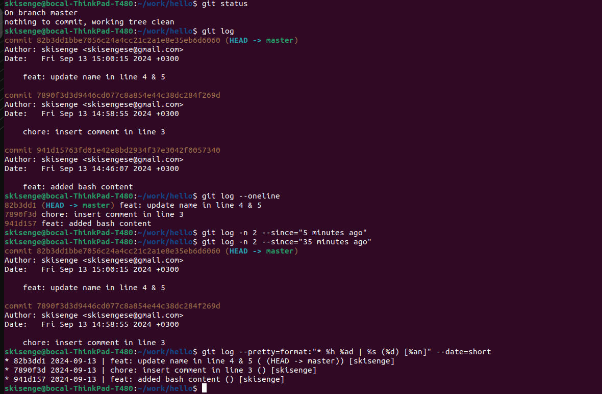
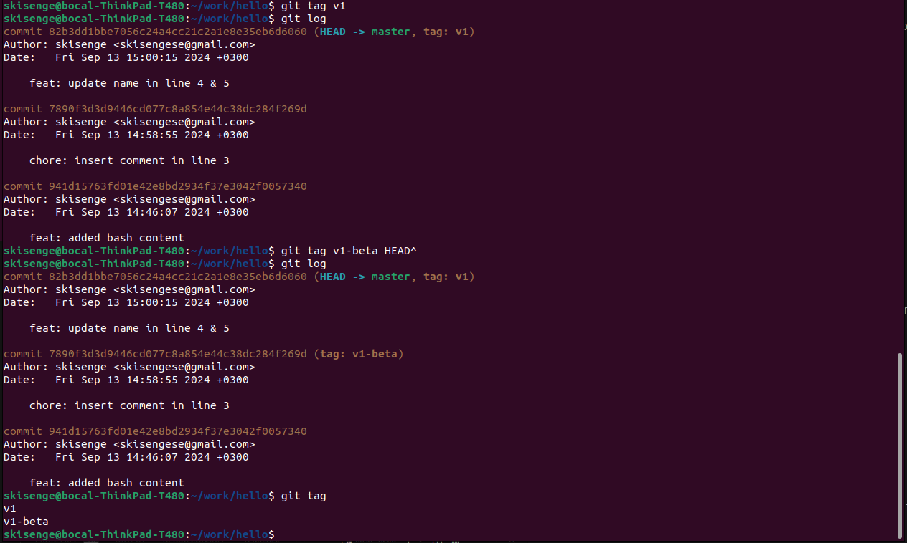
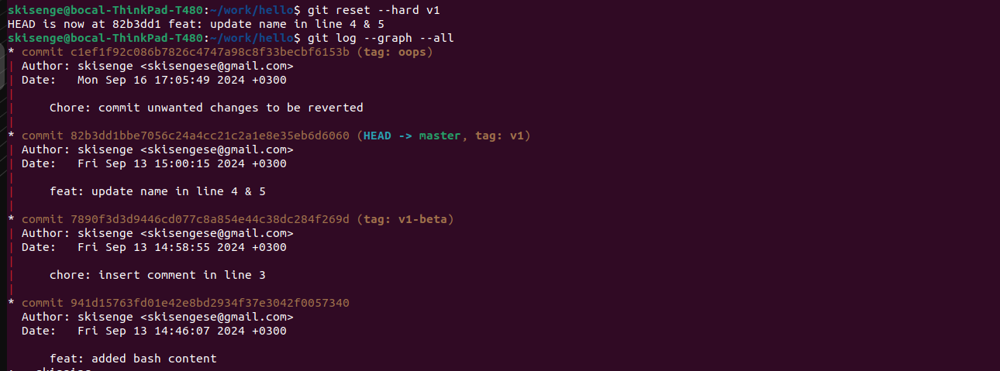
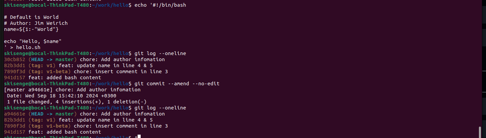

# Setting Up Git: A Comprehensive Guide

## Installing Git

To use Git, you'll need to install it on your local machine. Follow these steps based on your operating system:

### Windows

1. Download Git from the official Git website: [https://git-scm.com/downloads](https://git-scm.com/downloads)
2. Run the installer and follow the prompts.
3. After installation, you can use Git from the Command Prompt or PowerShell.
4. Git Bash, a Unix-like command line interface, is also installed and can be used as an alternative.

### macOS

1. Open the Terminal app.
2. Check if Git is already installed by running:

   ```bash
   git --version
   ```

3. If Git is not installed, you have two options:
   a. Install using Homebrew (if you have it installed):

      ```bash
      brew install git
      ```

   b. Download the installer from the official Git website: [https://git-scm.com/downloads](https://git-scm.com/downloads)

### Linux

Open a terminal and run one of the following commands:

- For Ubuntu-based systems:

  ```bash
  sudo apt-get install git
  ```

- For RHEL-based systems:

  ```bash
  sudo yum install git
  ```

## Configuring Git

After installing Git, configure it with your username and email address:

```bash
git config --global user.name "Your Name"
git config --global user.email "your_email@example.com"
```

Replace "Your Name" and "<your_email@example.com>" with your actual name and email address.

### Setting Default Branch Name

Many Git installations now default to 'main' instead of 'master'. Set your default branch name:

```bash
git config --global init.defaultBranch <default_branch>
git config --global init.defaultBranch master
```

### Verifying the Configuration

To verify your configuration:

```bash
git config --global --list
```

This will output a list of your configuration settings, including your username and email address.

## Advanced Setup (Optional)

### Setting Up SSH Keys

If you're using a Git hosting service like GitHub, you may want to set up SSH keys for secure, password-less authentication:

1. Generate an SSH key:

   ```bash
   ssh-keygen -t ed25519 -C "your_email@example.com"
   ```

2. Add the SSH key to your SSH agent:

   ```bash
   eval "$(ssh-agent -s)"
   ssh-add ~/.ssh/id_ed25519
   ```

3. Add the public key to your Git hosting service account.

### Global .gitignore

Create a global .gitignore file to specify files that Git should ignore across all repositories:

```bash
git config --global core.excludesfile ~/.gitignore_global
```

Then, edit `~/.gitignore_global` to add file patterns to ignore.

## Git GUI Clients

While Git is primarily used via command line, there are several GUI clients available for those who prefer graphical interfaces:

- GitHub Desktop
- Sourcetree
- GitKraken
- Tower

Choose one that suits your preferences and workflow.

## Conclusion

You're now set up to use Git on your local machine! Remember to regularly update Git to the latest version for security patches and new features.

---

# Git Commits to Commit

## Step 1: Create a Subdirectory and File

Within the work directory, establish a subdirectory named hello. Inside this directory, generate a file titled hello.sh and input the following content:

```bash
echo "Hello, World" >> hello.sh
```

## Initialize Git Repository and Check Status

- Initialize the Git repository in the hello directory using the command:

```bash
git init
```

- Check the status of the repository using the command:

```bash
git status
```

- The output should indicate that the directory is empty.

## Modify File and commit Changes

- Modify the hello.sh file to include comments and stage the changes:

```bash
#!/bin/bash

# Default is "World"
name=${1:-"World"}
echo "Hello, $name"
```

- Stage the changed file, but in patches, the first should include the line 3 comment while the other should noe include the rest of the lines 4 and 5. Use the command:

```bash
git add -p
```

## Commit Changes

- Commit 1: Commit the comment added in line 3.

```bash
git commit -m "add comment here"
```

- When we git status after this, we realize we have the same file in the staging area and as untracked, to mean we committed the first change but did not the later changes in the file. Commit 2: Commit changes made to lines 4 and 5.

```bash
git add hello.sh
git commit -m "Modified hello.sh script"
```

- The working tree should now be clean.

---

# _*History*_

## _*Show History*_

- To show the history of the working directory, run:

```bash
git log
```

### _*One-Line History*_

- To view a condensed one-line history showing only commit hashes and messages, run:

```bash
git log --oneline
```

### _*Customized Log Output*_

- To customize the log output, specify the number of entries or a time range. To display the last 2 entries, run:

```bash
git log -n 2
```

- To view the commits made within the last 5 minutes, run:

```bash
git log --since=5minutes
```

### _*Personalized Format*_

- To show logs in a personalized format, including the commit hash, date, message, branch information, and author name, run:

```bash
git log --pretty=format:"* %h %ad | %s (%d) [%an]" --date=short
```

- This will display the output in a format resembling:

```bash
* e4e3645 2023-06-10 | Added a comment (HEAD -> main) [John Doe]
```

- Note:
  - ``%h`` represents the commit hash
  - ``%as``  represents the date in the short format.
  - ``%ad`` represents the date in the long format.
  - ``%s`` represents the commit message
  - ``%d``  represents the abbreviated commit ref name (e.g. main)
  - ``%cr`` represents the commit message duration
  - ``%an``  represents the author name.

## Attached Display



---

# _*Checkout*_

## _*Restore First Snapshot*_

- Find the hash of the initial commit by running:

```bash
git rev-list --max-parents=0 HEAD
```

- Once you have the hash of the initial commit, detach the head to that commit and print the content:

```bash
git checkout <initial-commit-hash>
cat hello.sh
```

- To revert to initial version, run:

```bash
git checkout main/master
```

## _*Restore Second Recent Snapshot*_

- To revert the working tree to the second most recent snapshot and print the content of the hello.sh file, run:

```bash
git checkout HEAD~1
cat hello.sh
```

Also

```bash
git rev-list --skip=1 -n 1 HEAD
git checkout <second-recent-commit-hash>
cat hello.sh
```

- This will revert the working tree to the second most recent snapshot and display the content of the hello.sh file.

## _*Return to Latest Version*_

- To ensure that the working directory reflects the latest version of the hello.sh file present in the main branch, without referring to specific commit hashes, run:

```bash
git checkout main
cat hello.sh
```

- Note:
  - The ``HEAD~1`` syntax refers to the first parent commit of the current commit
  - ``HEAD~2`` refers to the second parent commit. By checking out these commits, you can revert to previous versions of your files.
  - After reverting to the initial commit, we cannot literally switch to the latest commit by the ``git checkout main`` command, since, the later commits were deleted. To reverse the process, you can track the latest commit hash by running ``git reflog`` and checkout revert to the hash, this will reset things back to normal.
  - ``git reflog:`` This command shows a log of changes to the tips of branches and other references in the repository. It includes actions like checkouts, commits, resets, and more.

  - ``git rev-list:`` This command lists commit objects in reverse chronological order.
  - ``--max-parents=0:`` This option filters the commits to only those with zero parents, which means it will list the root commits (initial commits) of the repository.
  - ``--skip=1:`` This option skips the first commit in the list. In this context, it skips the most recent commit.
  - ``-n 1:`` This option limits the output to only one commit.
  - ``HEAD:`` Refers to the latest commit in the current branch.


---

# _*Tagging*_

## _*Referencing Current Version**_

- To tag the current version of the repository as ``v1``, run:

```bash
git tag v1
```

- This will create a new tag v1 referencing the current commit.

## _*Tagging Previous Version*_

- To tag the version immediately prior to the current version as v1-beta, without relying on commit hashes to navigate through the history, run:

```bash
git tag v1-beta HEAD~1 (also HEAD^)
```

## _*Navigating Tagged Versions*_

- To move back and forth between the two tagged versions, v1 and v1-beta, use the following commands:
  - To switch to v1:

```bash
git checkout v1
```

- To switch to v1-beta:

```bash
git checkout v1-beta
```

## _*Listing Tags*_

- To display a list of all tags present in the repository to verify successful tagging, run:

```bash
git tag
```

- This will show a list of all tags in your repository, including v1 and v1-beta.
- And now if we `git log` we should be able to see this kind of an output.

## Tags Display



---

# _*Changed Your Mind?*_

## _*Reverting Changes*_

- Revert the changes back to their original state:-

```bash
# git checkout -- hello.sh
git restore hello.sh
```

- This will discard any local changes made to the file and restore it to its previous state.

## _*Staging and Cleaning*_

- Stage changes:

```bash
git add hello.sh
```

- Clean the staging area:

```bash
git restore --staged <filename>
# git reset HEAD <filename>
```

to discard the changes:

```bash
git restore <filename>
```

## _*Committing and Reverting*_

- Add the following unwanted changes again, stage the file, commit the changes, then revert them back to their original state, follow these steps:

```bash
git add hello.sh
git commit -m "Chore: commit unwanted changes to be reverted"
git revert HEAD^
```

## _*Tagging and Removing Commits*_

### _*Tagging the Latest Commit*_

- To tag the latest commit with ``oops``, run the following command:

```bash
git tag oops HEAD
```

### _*Removing Commits*_

- To remove commits made after the v1 version:

```bash
git reset --hard v1
```

### _*Ensuring HEAD Points to v1*_

- Verify that the HEAD now points to the commit with the tag v1 by running:

```bash
git log -1
```

## Tags display



### _*Displaying Logs with Deleted Commits*_

#### _*Showing Logs with Deleted Commits*_

- To display logs with deleted commits, including the one tagged as oops, run:

```bash
git log --graph --all
```

#### _*Cleaning Unreferenced Commits*_

- To ensure that unreferenced commits are deleted from history, use:

```bash
git prune
# git gc --prune=now
```

#### _*Author Information*_

- To add an author information to the file, open it in a text editor and add a line at the top:

```bash
#!/bin/bash

# Default is World
# Author: Jim Weirich
name=${1:-"World"}

echo "Hello, $name"

```

#### _*Adding the Author's email*_

- To do this without making a new commit!
- After making the changes on the file, we are going to do a special commit:

```bash
git commit --amend --no-edit
```

- This will update the commit message without changing the commit itself.



## **Note:**

### _**Key differences between git prune and git gc --prune=now:**_

**Pruning:** Both commands remove unreferenced objects, but `git prune` is more focused on this task, while `git gc` also performs other optimizations.

**Garbage collection:** `git gc` performs a more comprehensive cleanup of your repository, including repacking objects, which can improve performance.

**Timing:** ``git prune`` can be run independently, while `git gc` is typically part of a larger repository maintenance process.
